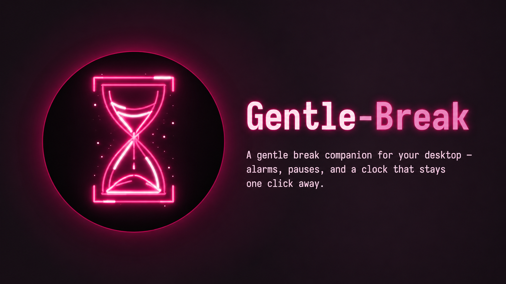

<!-- markdownlint-disable-next-line MD041 -->
<a id="top"></a>

<div align="center">



<h1>Gentle Break</h1>

<p><strong>A floating desktop clock with alarms and break reminders that live in your menu bar and nudge you without taking over your screen.</strong></p>

https://github.com/user-attachments/assets/36e2d4a1-5efa-42cb-9225-3a4eccee87d8

<p>


<a href="LICENSE"></a>
</p>

<p>
<a href="docs/install.md"><strong>Install</strong></a> &bull;
<a href="#releases"><strong>Releases</strong></a> &bull;
<a href="#development"><strong>Development</strong></a>
</p>

</div>

<br/>

> [!NOTE]
> **Early preview.** Gentle Break stays in the menu bar, floats on your desktop, and can ring even when the settings panel is closed. Try it first on a machine where an always-on widget works for you.

<br/>

## Features

- **Floating widget** — hourglass and pixel clock; drag to move, click to open the panel.
- **Alarms and breaks** — schedules and intervals with weekdays and a sound per event.
- **Do not disturb** — silences notifications and triggers without quitting the app.
- **When it rings** — choose an animation (characters, shake, bounce, heartbeat, or none); character reactions ship with their own embedded sounds.
- **Menu bar** — open the panel, hide or show the widget, do not disturb, quit.

<div align="right"><a href="#top">Back to top</a></div>

## Releases

<a id="releases"></a>

Installers are published on **[GitHub Releases](https://github.com/NahuelOrselli/gentle-break/releases)** when you push a `v*` tag (for example `v0.1.0`).

| Platform | CI artifact |
| --- | --- |
| macOS (Apple Silicon) | `Gentle Break_<version>_aarch64.dmg` |
| Windows | `.exe` (NSIS) |
| Linux (Debian/Ubuntu) | `.deb` |

Until the first release is published, build locally (below) or download **workflow artifacts** from [Desktop](.github/workflows/desktop.yml) in Actions.

Install steps, macOS first open, and uninstall: **[docs/install.md](docs/install.md)**.

<div align="right"><a href="#top">Back to top</a></div>

## Development

<a id="development"></a>

**Requirements:** Node.js 22+, Rust (stable), and [Tauri prerequisites](https://v2.tauri.app/start/prerequisites/) for your OS.

```sh
npm ci
npm run desktop     # Vite + Tauri dev
npm run build       # frontend only
npm run package:mac # macOS: .app + .dmg
npm run package     # installer for your OS
```

Tests:

```sh
cd src-tauri && cargo test --lib
```

### Shipping a version (maintainers)

1. Match the version in `package.json` and `src-tauri/tauri.conf.json`.
2. `git tag v0.1.0 && git push origin v0.1.0`
3. Actions builds macOS, Windows, and Linux and attaches installers to the release for that tag.

<div align="right"><a href="#top">Back to top</a></div>

---

<div align="center">

<h3>Gentle Break is open source under the MIT License</h3>

<br/>

<a href="LICENSE"></a>

</div>
